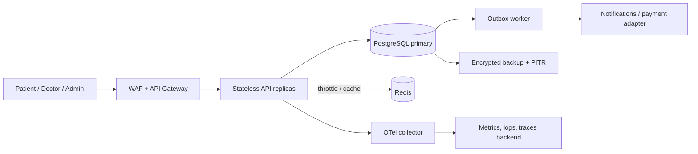

# Architecture and data flow

## 1. System shape

Clients reach a TLS-terminating edge/API gateway that enforces WAF rules and request size limits. FastAPI runs as stateless container replicas. PostgreSQL is the source of truth; the API throttles auth routes with Redis when configured and uses a local fallback for development. Public search caching is a production extension. A transactional outbox and worker tier is the production extension point for notifications, payment-provider calls, and other slow side effects. Object storage is reserved for encrypted clinical attachments if introduced.



## 2. Main flows and transaction boundaries

**Booking:** Patient authenticates, searches a doctor/slot, then submits a booking with `Idempotency-Key`. The API begins a database transaction, locks the selected availability row (`SELECT ... FOR UPDATE`), checks availability, creates consultation and audit rows, marks the slot booked, and commits. A unique constraint on slot and patient/key handles races and retries. Notifications should be enqueued after commit through a transactional outbox. Repeating the same key returns the original consultation. This reference slice implements the lock and idempotency; a durable outbox worker remains a production extension.

```mermaid
sequenceDiagram
  participant P as Patient
  participant API
  participant DB as PostgreSQL
  P->>API: POST consultation + Idempotency-Key
  API->>DB: Begin; check patient/key
  API->>DB: SELECT slot FOR UPDATE
  DB-->>API: Available row
  API->>DB: Insert consultation + audit; mark slot booked
  API->>DB: Commit
  API-->>P: 201 consultation ID
  Note over API,DB: Same-key retry replays; competing booking conflicts
```

**Consultation lifecycle:** `booked -> in_progress -> completed`; cancellation is allowed from booked/in-progress subject to policy. State transitions are checked on writes. Prescriptions are restricted to the assigned doctor (or admin) and readable only by the patient, assigned doctor, or admin. Sensitive mutations create audit events.

## 3. Data model

```mermaid
erDiagram
 USERS ||--o| PROFILES : has
 USERS ||--o| DOCTORS : represents
 DOCTORS ||--o{ AVAILABILITY_SLOTS : publishes
 USERS ||--o{ CONSULTATIONS : books
 DOCTORS ||--o{ CONSULTATIONS : attends
 AVAILABILITY_SLOTS ||--o| CONSULTATIONS : reserves
 CONSULTATIONS ||--o{ PRESCRIPTIONS : receives
 CONSULTATIONS ||--o| PAYMENTS : may_have
 USERS ||--o{ AUDIT_LOGS : acts
 USERS { uuid id PK; text email UK; text role; boolean is_active }
 DOCTORS { uuid id PK; uuid user_id FK; text specialty }
 AVAILABILITY_SLOTS { uuid id PK; uuid doctor_id FK; timestamptz starts_at; text status }
 CONSULTATIONS { uuid id PK; uuid patient_id FK; uuid doctor_id FK; uuid slot_id FK; text status; text idempotency_key }
 PRESCRIPTIONS { uuid id PK; uuid consultation_id FK; bytea body_ciphertext }
```

The full normalized production data model, checks, indexes, and deduplication constraints are in `../database/schema.sql`. It is a target model, not an executable migration for the demo ORM. The demo uses plaintext ORM text fields to remain locally runnable; the production model uses ciphertext columns. Do not use real health data until migrations, ORM mappings, and an approved envelope-encryption adapter are implemented and tested.

## 4. Capacity, latency, and resilience

100k consultations/day averages roughly 1.2 writes/second, but sizing must account for peak multiples and search bursts. Establish a load profile and indexes from query plans; scale API replicas horizontally, use connection pooling, bound search/pagination, and move analytics to read replicas or a warehouse. Redis caching suits public doctor search/availability with short TTL and invalidation on slot changes; never cache patient clinical data in shared keys. PostgreSQL constraints and row locks remain authoritative when cache data is stale.

Targets: p95 reads <200 ms, writes <500 ms, availability 99.95% (~22 minutes/month). Track per-route latency and error budgets. Use bounded timeouts, exponential backoff with full jitter for transient failures, capped attempts, and circuit breakers for external providers. Do not retry non-idempotent calls blindly. Use idempotency keys for writes and dead-letter queues for exhausted async jobs.

For payment/notification work, use a saga: persist local intent/outbox in the booking transaction; a worker calls the provider with a stable idempotency key; update payment state on response/webhook; compensate with cancellation/refund if a later step fails. Never hold a DB transaction open during provider calls.

## 5. Partitioning, backup, and disaster recovery

Start with indexed tables and measure. At higher history volume, range-partition consultations and audit logs by month, retain hot partitions for operational queries, archive old audit data to immutable storage, and preserve global idempotency semantics (a separate unpartitioned idempotency ledger may be needed). Use managed PostgreSQL multi-zone primary/standby, encrypted automated backups, point-in-time recovery, and regular isolated restores. Proposed objectives are RPO <=5 minutes and RTO <=60 minutes, validated quarterly. Redis is disposable and rebuilt from source-of-truth state.
